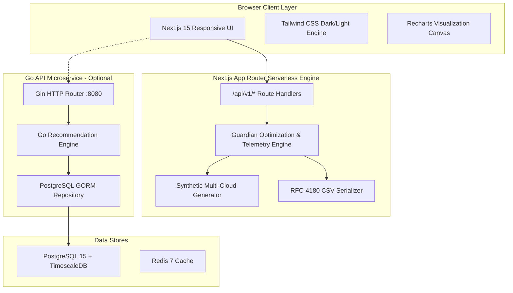

# CloudCost Guardian — Architecture & Technical Specifications

## 1. Architectural Philosophy
CloudCost Guardian is engineered with a **resilient dual-mode architectural model**:
1. **Integrated Serverless Mode (Production Default):** Next.js 15 App Router provides full-stack functionality where frontend UI and REST API handlers (`/api/v1/*`) execute co-located in serverless Node.js runtimes. This guarantees zero-friction deployments on Vercel or cloud containers without requiring external database provisioning.
2. **Microservices Container Mode (Enterprise Self-Hosted):** The Go 1.23 Gin API service (`backend/`) communicates with TimescaleDB / PostgreSQL and Redis for high-throughput time-series ingestion and asynchronous job execution.



---

## 2. Directory Structure
```
cloudcost-guardian/
├── .github/
│   └── workflows/
│       ├── ci.yml                 # Automated CI/CD (Node, Go, Docker)
│       └── contributor-tracking.yml
├── backend/                       # Go Microservice API
│   ├── cmd/api/main.go            # Go HTTP entrypoint
│   ├── internal/services/         # Rightsizing & recommendation logic
│   ├── migrations/                # PostgreSQL schema migrations
│   └── Dockerfile                 # Go container build
├── frontend/                      # Next.js 15 Full-Stack Application
│   ├── app/
│   │   ├── api/v1/                # Full-Stack Serverless REST Endpoints
│   │   │   ├── accounts/
│   │   │   ├── alerts/
│   │   │   ├── auth/
│   │   │   ├── dashboard/
│   │   │   ├── data-quality/
│   │   │   ├── export/csv/
│   │   │   ├── health/
│   │   │   ├── metrics/
│   │   │   ├── recommendations/
│   │   │   └── resources/
│   │   ├── accounts/              # Multi-cloud accounts view
│   │   ├── alerts/                # Threshold alerts view
│   │   ├── analytics/             # Utilization time-series view
│   │   ├── dashboard/             # Executive overview view
│   │   ├── data-quality/          # Pipeline quality view
│   │   ├── idle/                  # Idle & zombie detection view
│   │   ├── login/                 # Branded login with demo access
│   │   ├── recommendations/       # Rightsizing view
│   │   ├── register/              # Account registration
│   │   ├── reports/               # CSV reports download view
│   │   ├── resources/             # Fleet inventory view
│   │   ├── layout.tsx             # Root layout with ThemeProvider
│   │   └── page.tsx               # Academic project landing page
│   ├── components/
│   │   ├── layout/                # Sidebar, Header, GuardianLayout
│   │   ├── theme/                 # ThemeProvider, ThemeToggle
│   │   └── ui/                    # Reusable Button, Card, Spinner, Skeleton
│   ├── lib/
│   │   ├── api.ts                 # Client API layer & interceptors
│   │   ├── guardian-engine.ts     # Core calculation & telemetry engine
│   │   └── utils.ts               # Currency and formatting utilities
│   ├── tests/
│   │   └── guardian-engine.test.ts # Vitest automated test suite (20 tests)
│   ├── Dockerfile                 # Standalone production container build
│   └── package.json
├── docs/                          # Academic documentation & architecture
│   ├── ARCHITECTURE.md
│   └── COLLEGE_PROJECT_REPORT.md
├── docker-compose.yml             # Orchestration for full 4-service stack
├── LICENSE                        # Apache 2.0 License
└── README.md                      # Comprehensive project guide
```
