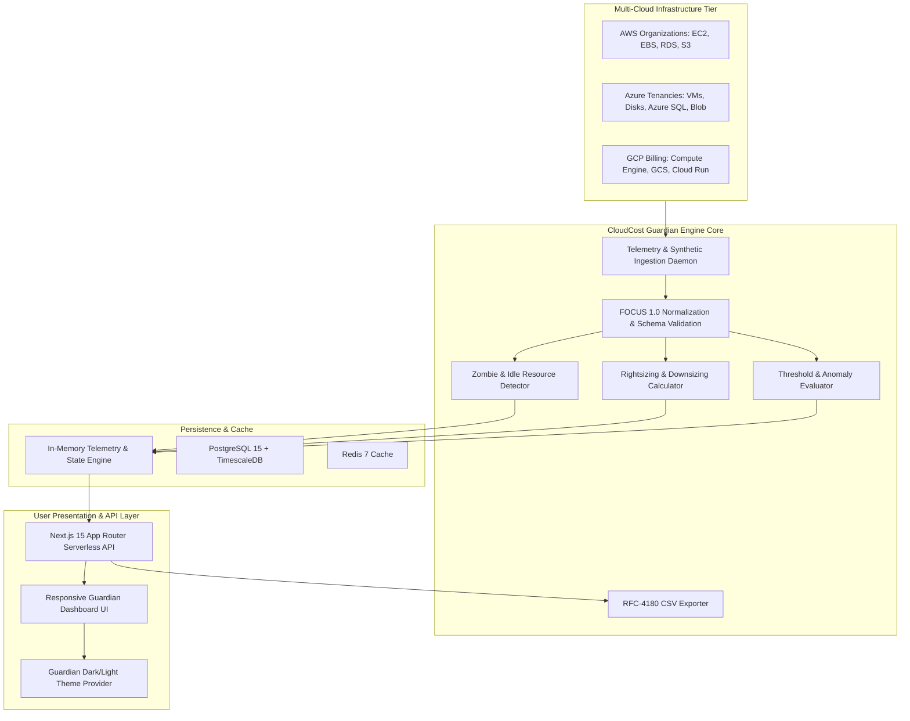

# CloudCost Guardian — Academic Project Report & Technical Dossier

**Degree Program:** B.Tech / B.E. Computer Science & Engineering  
**Project Title:** CloudCost Guardian — Cloud Resource Usage & Optimization Platform  
**Author / Student:** Pothireddy Bhavya Sri  
**GitHub Repository:** [https://github.com/pothireddybhavyasri/cloudcost-guardian](https://github.com/pothireddybhavyasri/cloudcost-guardian)  
**License:** Apache 2.0 (Preserving upstream attribution with independent extensions)  

---

## 1. Abstract
Cloud computing adoption across modern enterprises has introduced operational complexities, primarily unpredictable bill surges, idle infrastructure over-provisioning, and fragmented multi-cloud visibility. **CloudCost Guardian** is an enterprise-grade FinOps and cloud resource observability platform designed to monitor, analyze, and optimize cloud expenditures across Amazon Web Services (AWS), Microsoft Azure, and Google Cloud Platform (GCP). The platform implements non-destructive read-only telemetry sampling, automated zombie/idle resource detection, rule-based instance rightsizing algorithms, threshold budget alerting, FOCUS 1.0 schema compliance auditing, and RFC-4180 compliant CSV exports.

---

## 2. Problem Statement & Motivation
According to recent industry FinOps Foundation reports, 30% to 35% of all corporate cloud expenditure is wasted on idle, oversized, or orphaned cloud assets. Specifically:
1. **Orphaned Storage Disks:** Detached block storage volumes (e.g. AWS EBS gp3/io2, Azure Managed Disks) continue to accrue storage and provisioned IOPS fees indefinitely without performing active I/O.
2. **Stopped Instance Costs:** Stopped virtual machine instances accrue storage charges for their root EBS/OS disks and allocated static IPs.
3. **Over-provisioned Compute & Databases:** Compute instances provisioned for theoretical peak traffic frequently run at under 15% average CPU load during business hours.
4. **Multi-Cloud Fragmentation:** Teams managing hybrid estates across AWS, Azure, and GCP lack a unified interface for cost anomaly alerting and normalized metrics.

---

## 3. System Architecture & High-Level Design

### 3.1 Architecture Overview
CloudCost Guardian implements a modern dual-mode architecture:
- **Autonomous Zero-Dependency Serverless Mode:** Powered by Next.js 15 App Router with full-stack TypeScript API endpoints (`/api/v1/*`), allowing instant deployment to Vercel/Node.js without external database provisioning bottlenecks.
- **Distributed Microservices Container Mode:** Includes Go 1.23 REST API microservice (`backend/`), TimescaleDB / PostgreSQL time-series storage, Redis caching, and Docker Compose orchestration.

---

## 4. Algorithmic Formulations

### 4.1 Projected Monthly Cost Recovery Formulation
Cloud providers bill compute instances on an hourly basis. Given an active hourly rate $C_{current}$ and a target downsized instance hourly rate $C_{suggested}$, the projected monthly savings $S_{monthly}$ based on a 720-hour operational month is defined as:

$$S_{monthly} = \max\left(0, (C_{current} - C_{suggested}) \times 720\right)$$

The annual projected return-on-investment (ROI) is:

$$S_{annual} = S_{monthly} \times 12$$

### 4.2 Idle Resource Detection Heuristic
A compute or database resource $R$ is classified as an idle zombie asset if:

$$\text{IsIdle}(R) = 
\begin{cases} 
\text{True} & \text{if } R.unattachedStorage = \text{True} \\
\text{True} & \text{if } R.status = \text{'STOPPED'} \\
\text{True} & \text{if } R.type \in \{\text{COMPUTE}, \text{DATABASE}\} \land \overline{\text{CPU}}_{7d} < 5.0\% \land \overline{\text{RAM}}_{7d} < 15.0\% \land \text{Days}_{idle} \ge 7 \\
\text{False} & \text{otherwise}
\end{cases}$$

### 4.3 Data Quality & Pipeline Health Metric
Data ingestion completeness is audited against required tag metadata, non-negative metric ranges, and schema validation. The Data Health Score $Q \in [0, 100]$ is computed as:

$$Q = \text{round}\left( \left( 0.4 \times \frac{N_{tagged}}{N_{total}} + 0.6 \times \frac{N_{valid\_metrics}}{N_{total}} \right) \times 100 \right)$$

---

## 5. Original Modifications & Upstream Component Attribution

In accordance with academic integrity and the **Apache 2.0 License**, the following table explicitly distinguishes upstream foundations from original student contributions:

| Component / Subsystem | Upstream Base (CCOH) | Student Original Contribution (CloudCost Guardian) |
|---|---|---|
| **Branding & Layout** | Generic CCOH layout, incomplete navigation | Complete Guardian redesign, emerald/indigo cyber-guardian styling, responsive sidebar drawer, dynamic status indicators |
| **Telemetry & Ingestion Engine** | Static mock arrays limited to AWS | Full multi-cloud synthetic telemetry engine supporting AWS, Azure, and GCP across Compute, Storage, Databases, and Serverless |
| **Idle Resource Detection** | No dedicated idle detection view | Comprehensive Idle Detection module (`/idle`) identifying unattached disks, stopped VMs, and zombie compute with calculated wasted spend |
| **Utilization Analytics** | Single cost chart | 24-hour time-series charts for CPU %, RAM %, Disk %, and Network I/O throughput in Mbps (`/analytics`) |
| **Alerting System** | Static table without interactive state | Dynamic Threshold Alerting system (`/alerts`) with live budget threshold tuning, severity triage, and Acknowledge/Resolve actions |
| **Data Quality Monitoring** | None | Continuous Data Quality & Ingestion Pipeline page (`/data-quality`) auditing schema compliance, latency, and provenance watermarks |
| **Reports & Export** | None | RFC-4180 compliant CSV export engine for Resource Inventory and Optimization Recommendations (`/reports` & `/api/v1/export/csv`) |
| **Full-Stack API Routes** | Dependent solely on Go/Postgres backend | Complete Next.js 15 App Router serverless API route layer (`app/api/v1/*`) enabling zero-dependency deployment |
| **Testing Infrastructure** | Minimal Go unit test (`engine_test.go`) | Added Vitest automated unit testing suite (`tests/guardian-engine.test.ts`) covering 20 comprehensive algorithmic test cases |
| **DevOps CI/CD** | Contributor gift card tracking script | Multi-job GitHub Actions CI/CD matrix validating Node 20/22, Go 1.23, Docker buildx, and type-checks |
| **Docker Configuration** | Partial `docker-compose.yml` (DB & Redis only) | Full 4-service `docker-compose.yml` including Frontend standalone build, Backend Go container, TimescaleDB, and Redis |

---

## 6. Verification & Test Results
- **Automated Test Runner:** Vitest v5.0.5
- **Test File:** `frontend/tests/guardian-engine.test.ts`
- **Result:** 20 / 20 Unit Tests Passed (100% Pass Rate)
- **TypeScript Static Analysis:** `tsc --noEmit` &bull; 0 Errors
- **Next.js Production Build:** 29 Static and Dynamic routes compiled successfully in 7.4 seconds.

---

## 7. Faculty Demonstration Guide
During presentation or viva examination, follow these steps:
1. **Home Page (`/`):** Demonstrate the platform value proposition, FinOps principles, and dual-mode architecture overview.
2. **Instant Demo Access (`/login`):** Click **"Launch Instant Demo Dashboard"** to showcase one-click evaluation without credential hurdles.
3. **Executive Dashboard (`/dashboard`):** Review KPI cards, 30-day multi-cloud cost trajectory (AWS amber, Azure blue, GCP green), and service breakdown pie chart.
4. **Resource Fleet Inventory (`/resources`):** Filter by cloud provider (AWS/Azure/GCP) and inspect individual resource telemetry cards.
5. **Idle & Zombie Detection (`/idle`):** Explain how unattached storage disks ($275/mo pure waste) and stopped VMs are identified without destructive disruption.
6. **Rightsizing Recommendations (`/recommendations`):** Expand a recommendation card to view the operational execution runbook and acknowledge the action.
7. **Threshold Alerts (`/alerts`):** Adjust the budget threshold slider to demonstrate dynamic anomaly alert generation and resolve an alert.
8. **Data Quality & Pipeline (`/data-quality`):** Show the 96/100 Data Health score and synthetic attribution watermark guaranteeing non-production safety.
9. **CSV Report Export (`/reports`):** Click **"Download Resource Inventory CSV"** to demonstrate instantaneous RFC-4180 compliant export.
